# QuestBlock

**Screen time you earn.** Finish quests, collect coins, and spend them to open the apps you locked.

QuestBlock is an Android app (Kotlin, Jetpack Compose, Hilt, Room) that turns self-discipline into a small RPG.
An accessibility service watches for locked apps and shows a lock screen until you pay coins or finish a quest.
It works with any launcher, and it also ships its own optional launcher (Quest Home) and a full Termux-style terminal theme.

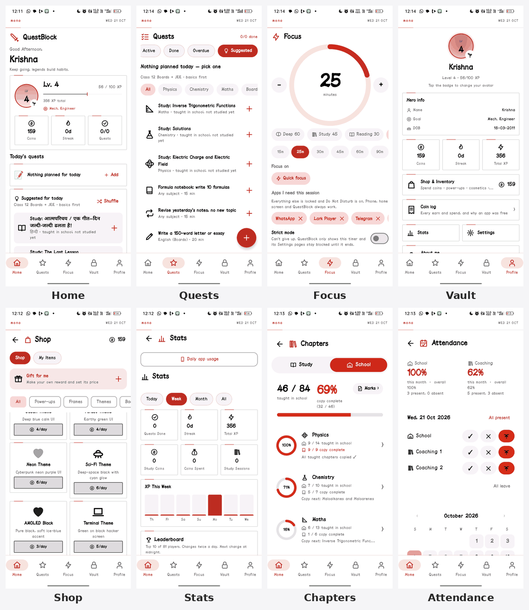

## What it does

| Area | Highlights |
| --- | --- |
| **Quests and rewards** | Six quest types (Daily, Weekly, One-time, Challenge, Routine with steps, Focus timer). Category, difficulty, priority, due dates, repeat on chosen days. XP and coins per quest, one-tap undo. |
| **Locking and coins** | Lock apps, websites, Shorts and Reels. Hold to unlock, paid in coins per 5 minutes. Free opens for study apps, Focus quests, daily-limit apps and hours outside the lock schedule. Coin log names the reason for every earn and spend. |
| **YouTube gate** | Study videos pass, fun videos cost coins, Shorts counter, study-first page for chapters you have not studied. |
| **Focus** | Ring timer, per-session app list, background sound (Rain, Brown, Pink, White). Strict focus locks every app except the Focus tab. |
| **School** | Attendance (school and coaching), homework tracker, chapter progress, marks feeder (MT 1 to MT 3), weekly review, mood check-in. |
| **Player** | Level, XP, rank, hero profile, avatars, badges, Stats with a daily leaderboard, Hub with goals, rules and experiments. |
| **Shop and inventory** | Power-ups, prizes, badges, frames and 30+ themes bought with coins. Make your own rewards with Gift for me. |
| **Reliability** | Keep-alive service and watchdog, per-brand autostart shortcuts, battery exemption guide, Self test, Debug log. |
| **Tools** | Encrypted backup and safe restore, home-screen widget, Quest Home launcher, Ideas page (write the next update and copy it into a chat), Flags page, Version info. |

The full in-app feature list is in `data/AppFeatures.kt` (About me > Why I built QuestBlock).

## Themes

Themes recolour the whole app. The newer style themes also change shapes, fonts, borders, the Focus ring, the XP bar, level-up, the lock screen and the quest-done pop. Each theme has a switch and a try-it page under Flags.

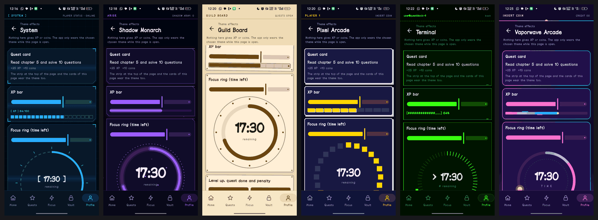

Left to right: System Window, Shadow Monarch, Guild Board, Pixel Arcade, Terminal, Vaporwave Arcade.

### Style themes

| System Window | Shadow Monarch | Hashira Mist | Gothic Halo |
| :---: | :---: | :---: | :---: |
| 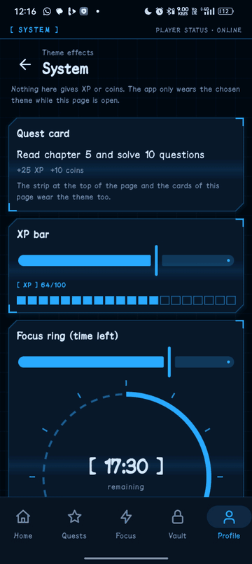 | 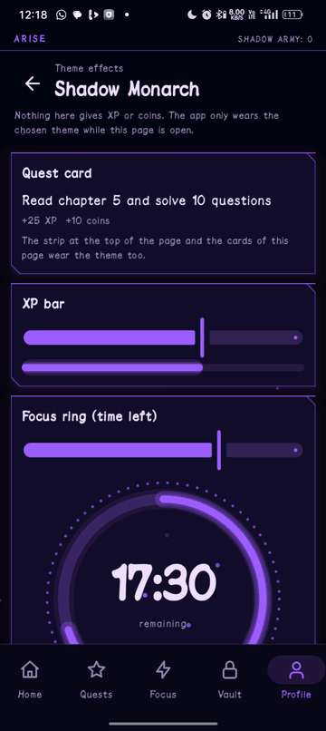 | 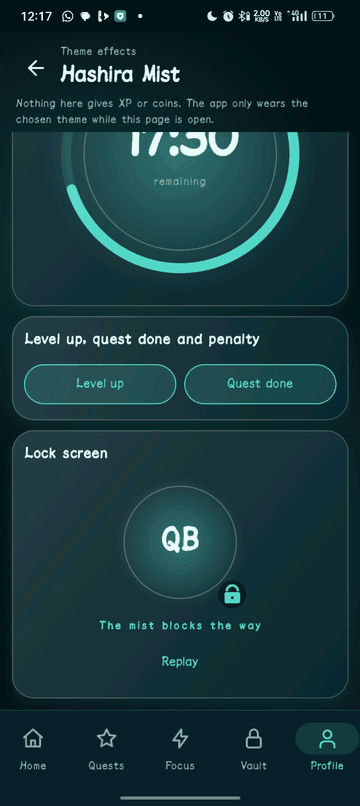 | 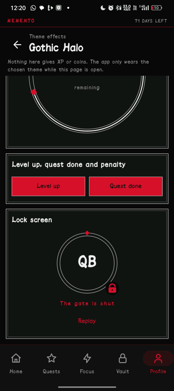 |
| Blue RPG system windows, HUD grid | Black and violet, rising shadow motes | Frosted teal glass, drifting mist | Black and white, one red accent |

| Guild Board | Pixel Arcade | Handheld | Blueprint |
| :---: | :---: | :---: | :---: |
| 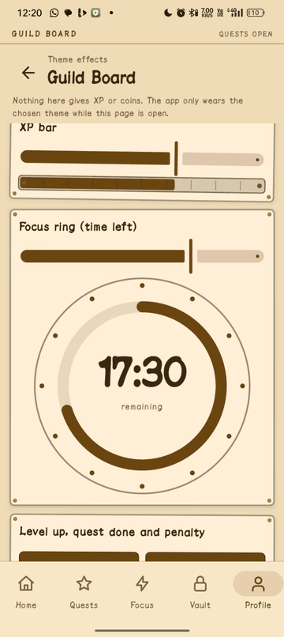 | 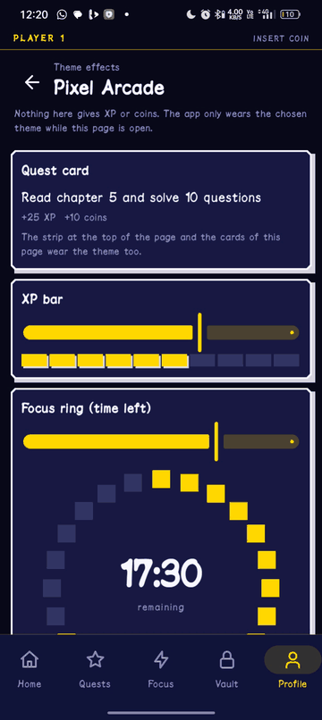 | 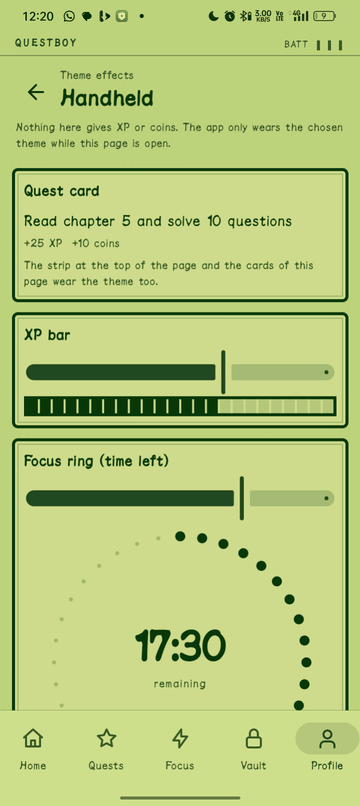 | 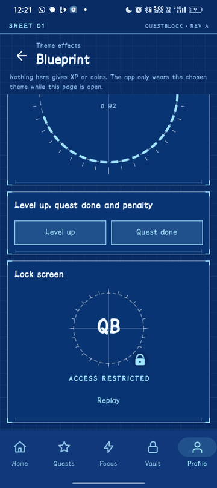 |
| Parchment, brass studs, serif titles | Chunky corners, INSERT COIN strip | Green LCD, dot matrix | White lines on blueprint blue |

Ninja Scroll (washi paper, red hanko seals) is the ninth style theme.

### Minimal and maximal themes

| Zen | Whitespace | Carnival | Baroque | Vaporwave Arcade |
| :---: | :---: | :---: | :---: | :---: |
| 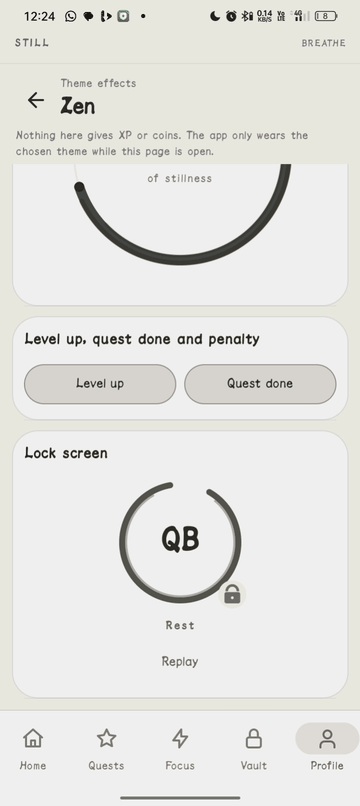 | 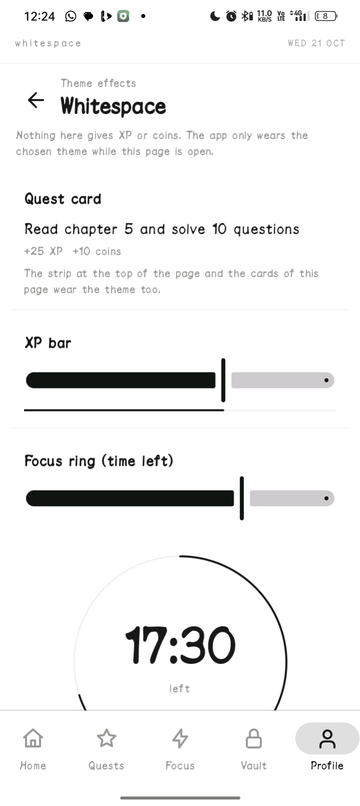 | 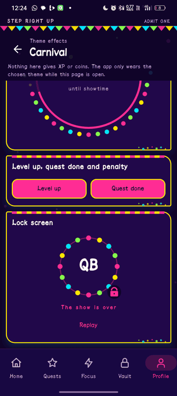 | 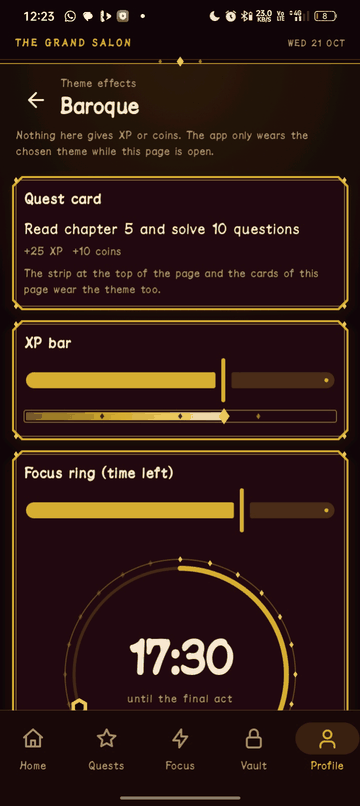 | 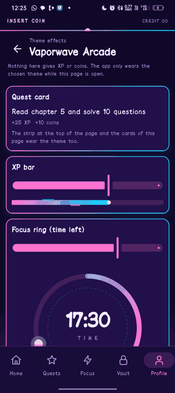 |
| Ensō brush circle, no sounds | Huge margins, no card borders | Neon stripes, fireworks | Gold-leaf frames, wax seal | Sun grid, chrome text, glitchy XP |

Mono is the third minimal theme.

### Colour themes

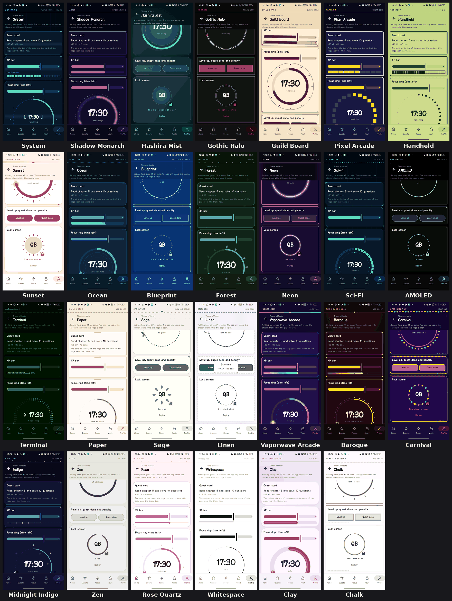

Also in the shop: Sky Paper, Lilac Paper, Mono and Ninja Scroll. Two app themes are free: **Quest Phone** (the normal pages) and **Termux** (the whole app as one terminal).

## First-time setup from Termux

```bash
pkg install -y unzip
unzip QuestBlock.zip -d ~ && cd ~/QuestBlock
bash termux/setup.sh            # optional arg: repo name (default: questblock)
```

`setup.sh` installs git and gh (plus a JDK only if `keytool` is missing), generates a keystore in `~/.questblock/`,
creates the private GitHub repo, uploads the keystore as Actions secrets, pushes, waits for CI, then downloads and opens the signed APK.

## Every change after that

```bash
bash termux/release.sh "message"
```

Commits, pushes, waits for the GitHub Actions build and downloads the signed APK. If the build fails, the compile errors are printed and saved to `~/build_errors.txt` so you can paste them back.

Full-zip update (the command the Ideas page generates):

```bash
cd ~ && unzip -oq ~/storage/downloads/QuestBlock_vN.zip -d ~/qbN && cp -r ~/qbN/QuestBlock_vN/. ~/QuestBlock/ && rm -rf ~/qbN && cd ~/QuestBlock && bash termux/release.sh "vN: short summary"
```

## On the phone

1. Install the APK, open QuestBlock and follow onboarding.
2. Enable the accessibility service. If it is greyed out (Android 13+ sideload): App info > ⋮ > **Allow restricted settings**.
3. Grant overlay, usage access, notifications and the battery exemption. Device Admin is optional.
4. In the Vault, toggle the apps to lock. Tap the tune icon to set a per-app price, daily limit or lock hours.
5. Turn on Strict mode to get bounced out of Settings pages that show QuestBlock.
6. Open Settings > Reliability and follow the autostart shortcuts for your phone brand.

### Permissions

| Permission | Used for |
| --- | --- |
| Accessibility service | Detecting a locked app coming to the foreground and showing the lock screen |
| Draw over other apps | Lock screen and unlock timer overlay |
| Usage access | Screen-time numbers, daily limits and the Usage page |
| Notification access | Detecting which music app is playing (Music log and focus sound) |
| Notifications, foreground service | Unlock countdown, quest reminders, keep-alive |
| Battery optimisation exemption, boot completed | Keeping the blocker alive after a restart |
| Device Admin (optional) | Harder to uninstall during Strict mode |
| Internet | Fetching YouTube video info for the YouTube gate |

## Project layout

```
app/src/main/java/com/krishna/questblock/
  data/      Room database, repositories, Prefs, shop catalog, flags, YouTube gate, version log
  engine/    Progression, XP and coin rules, insights, auto-verifier
  service/   Accessibility blocker, keep-alive service, widget, reminders, media listener
  ui/        Compose screens, themes (Theme*.kt, ThemeFx*.kt), Termux terminal (Termux*.kt), Quest Home launcher
  util/      Backup, haptics, sounds, autostart, debug log
  di/        Hilt module
termux/      setup.sh and release.sh
docs/        README images (screenshots, themes) and the early changelog
```

Database version 9 (migrates without wiping data). minSdk 26, target and compile SDK 35.

## Notes

- Back up `~/.questblock/`. The same keystore is needed for every future update of the installed app.
- Without the keystore secrets CI falls back to debug signing, so builds never fail for that reason.
- No Gradle wrapper is committed. CI installs Gradle 8.10.2. Run `gradle wrapper` once if you want a local one.
- Release notes for every version are in the app (Profile > Version info) and in `data/VersionLog.kt`. Versions 7 to 18 are in [docs/CHANGELOG-early.md](docs/CHANGELOG-early.md).
- It is a self-discipline tool: safe mode or ADB can still get around it.
